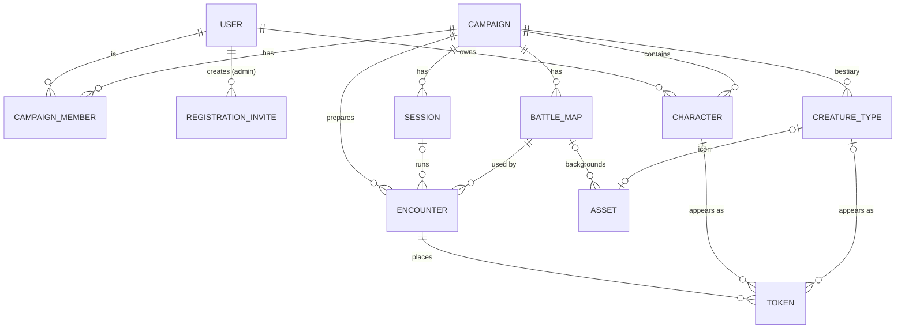

# Diagram

# Entities

[User](/domain/user.md), [Registration invite](/domain/registration-invite.md), [Campaign](/domain/campaign.md), [Campaign member](/domain/campaign-member.md), [Character](/domain/character.md), [Session](/domain/session.md), [Encounter](/domain/encounter.md), [Battle map](/domain/battle-map.md), [Creature type](/domain/creature-type.md), [Token](/domain/token.md), [Asset](/domain/asset.md).

# "Only one active" rules

- A campaign has at most one active session: `Campaign.activeSessionId`.
- A session has at most one active encounter: `Session.activeEncounterId`.
- Players opening the app land on the active encounter of their campaign's active session.

# Changes from the original proposal

The brief proposed User, Character, Campaign, Session, Fight and Creature.[^brief] Planning refined this:

| Original | Now | Why |
|----------|-----|-----|
| Fight | [Battle map](/domain/battle-map.md) + [Encounter](/domain/encounter.md) | A map is reusable; an encounter is one fight on it. DMs prepare encounters before game night, so an encounter belongs to the campaign and is linked to a session when it runs. |
| Creature | [Creature type](/domain/creature-type.md) + [Token](/domain/token.md) | "Goblin" (size, speed, icon) is defined once; "Goblin 3 at (4,7)" is a token. Icons are generated per type, as the brief asks. |
| — | [Token](/domain/token.md) also for characters | Characters and creatures stand on the board the same way, so moving and syncing works the same for both. |
| — | [Campaign member](/domain/campaign-member.md) | Who belongs to a campaign, and in which role, is stored once instead of per session. |
| Session DM = creator | `Session.dmUserId` and `Session.createdByUserId` kept separate | The brief says the DM can vary per session. The person who creates the session isn't always the one running it. |
| — | [Asset](/domain/asset.md) | Generated images need a prompt, model, status and several versions to choose from. |

[^brief]: Original project brief
